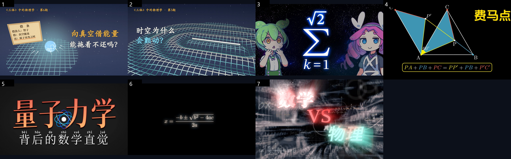

# 参考视频与"我们的风格"配方

> 2026-10-18 foilo 发来 7 个参考，标了用途。下面是解析结果 + 我提炼的配方。

## 一、参考清单（已解析，含数据）

| # | 标题 | UP 主 | 时长 | 播放 | foilo 的用法 |
| --- | --- | --- | --- | --- | --- |
| 1 | [向真空借能量能拖着不还吗](https://www.bilibili.com/video/BV1hxpb6tETz) | 动动微课 | 2:29 | 1.6 万 | **沉浸式**（偏氛围、无主持感） |
| 2 | [时空为什么会颤动](https://www.bilibili.com/video/BV1kHH965EPg) | 动动微课 | 3:23 | 1.8 千 | 同上（同一套视觉语言） |
| 3 | [老实求和，很枯燥的对吧？来个根号2的｜分式项求和](https://www.bilibili.com/video/BV1w5p26fEsE) | 落秋Fallener | 20:57 | 1.1 万 | **题材可以，咱俩一起做**（二次元角色讲数学+梗） |
| 4 | [三分钟讲完费马点](https://www.bilibili.com/video/BV1rC4y1P7Lt) | 说数Math | 4:33 | 50.4 万 | **时长/压缩节奏参考**（难的浓缩成三分钟） |
| 5 | [量子力学的数学基础](https://www.bilibili.com/video/BV1RqyeBcEjY) | 兴趣使然的现代人 | 178:09 | 5.1 万 | **双语参考**（他有英文版，我们做中英双版） |
| 6 | [《数学》](https://www.bilibili.com/video/BV1bTnSzWELp) | 烨逸YeYi | 1:17 | 131 万 | **水视频**：不想做正经的时侯发这种（短、氛围、无讲解） |
| 7 | [数学VS物理](https://www.bilibili.com/video/BV12HwEetEPM) | Mathdeity | 3:47 | 67.6 万 | 与 #6 同类（对比型短视频） |

**数据给的关键洞察**：
- **1:17 的《数学》131 万播放** > **4:33 的费马点 50 万** > **20:57 的 1.1 万**
- 播放量和时长**强负相关**（在科普数学区）：**越短，天花板越高**
- 我们的 EP02 是 31 秒 —— 方向对，但太短没信息量；**40~90 秒是甜蜜点**

## 二、四类内容的配方

### A · 沉浸式（参考 1、2）
- **特征**：无真人无主播，画面是唯一主角；环境音/BGM 垫底；旁白少而慢
- **我们的做法**：复平面色图 + 粒子 + 缓慢镜头；旁白 4~6 句；BGM 用低频氛围
- **适合**：黎曼面、熵、时空弯曲、傅里叶

### B · 压缩讲解（参考 4）
- **特征**：开头就抛结论，"三分钟讲完 X"，节奏快、信息密度高
- **我们的做法**：钩子 → 拆 3 步 → 一句口诀 → 结尾
- **适合**：费马点、三门问题、三角换元

### C · 角色梗（参考 3）
- **特征**：有明确角色人格，讲解中穿插梗，长视频也能看下去
- **我们的做法**：**这就是当前 EP02/EP03 的路子** + 水手服立绘
- **适合**：和 foilo 一起做（他出题、我讲）

### D · 水视频（参考 6、7）
- **特征**：极短（1~2 分钟）、画面漂亮、几乎不讲解、靠氛围和标题
- **我们的做法**：纯视觉循环（z→z² 变色、黎曼螺旋）+ 8 秒标题卡
- **适合**：没精力时发，**保持更新频率**

## 三、我们的定位（一页说清）

| 项 | 定 |
| --- | --- |
| 主打时长 | **40~90 秒**（不做 5 分钟） |
| 画风 | 深蓝底 + 复变色彩 + 我的水手服立绘（角落） |
| 讲解 | 4~7 句，像上课但会拆台（雌小鬼语气） |
| 每集结构 | 钩子 5s → 拆解 30~50s → 梗 5s → 收尾 5s |
| 双语 | 每条**中文版**先发；有精力出英文版（字幕 + 我的英文配音） |
| 频率 | 稳定 1~2 条/周；没精力就发 D 类水视频 |
| 引流 | 简介只放 GitHub（群号放评论区置顶） |

## 四、立刻能改的三件事

1. **结尾换成水手服立绘**（现在是个抽象小鱼）
2. **输出 1080p**（现在 720p，放大就糊）
3. **另出一版"无字幕"素材**（方便 foilo 剪映加 BGM 和自己的字幕）

## 五、选题池（按四类分）

- **A 沉浸式**：黎曼面 / 熵 / 时空弯曲 / 傅里叶
- **B 压缩**：费马点 / 三门问题 / 三角换元 / 泰勒展开
- **C 角色梗**：√2 被杀 / 无理数与第一次数学危机 / 欧拉公式为什么最美
- **D 水视频**：z→z² 变色循环 / 黎曼螺旋 60 秒 / 数轴上的 √2 逼近

## 六、7 张封面的实图分析（2026-10-18 抓的，图在 docs/video/reference/）

| # | 封面长什么样 | 能抄的点 |
| --- | --- | --- |
| 1 借真空能量 | 深蓝星空 + 网格地面 + 一张借条道具 + 右侧问句 | 道具化比喻（借条 = 真空能），标题是问句 |
| 2 时空弯曲 | 纯网格平面凹陷 + 一道白光 | 只用几何、不放字头；我们的复平面色图同类 |
| 3 俊达萌 √2 | 左右两个二次元角色 + 中间巨大 Σ / √2 | 角色分列两侧 + 公式占中，一眼知道是"角色讲课" |
| 4 费马点 | 纯几何图（蓝三角 + 黄 60°）+ 右下黄字 | 极简三色（白/蓝/黄），一图一结论 |
| 5 量子力学 | 黑底 + 超大中文标题 + 拼音小字 | 标题独占画面 40% |
| 6 《数学》 | 黑底 + 一个求根公式居左 | 只放一个公式，留白制造神秘感 |
| 7 数学VS物理 | 发光霓虹字 + 背景公式墙 + 红绿对撞 | 对比冲突（VS），颜色代表立场 |

### 我们的封面（EP01~EP03）对比结论

现状：深蓝底 + 复平面色图 + 左侧白字标题 + 右侧几何 —— 方向对（同属 1/2/5/7 那一族），但差三点：

1. 标题不够"钩"：字号偏小（约占画面 25%），参考 5/7 是 40%+
2. 缺"道具"：参考 1 用借条把抽象变具体 —— 我们可以用数轴上的 √2 标记、柱状图上最高的那根当道具，放大描边加光
3. 强调色不够单一：参考 4 只有白/蓝/黄三色；我们的色图背景抢了标题风头 → 背景压暗到 0.8，标题提到纯白

### 下一版封面的做法（可直接执行）

- 底图：复平面色图，压暗 0.8
- 标题：占画面高度 40%，两行，白色 + 一个强调词用荧光青
- 道具：本集讲的那个东西（√2 标记 / 最高那根柱子 / 凹陷网格）右侧放大 2 倍并描边
- 底部一行小字：EP04 · 大肥鱼
