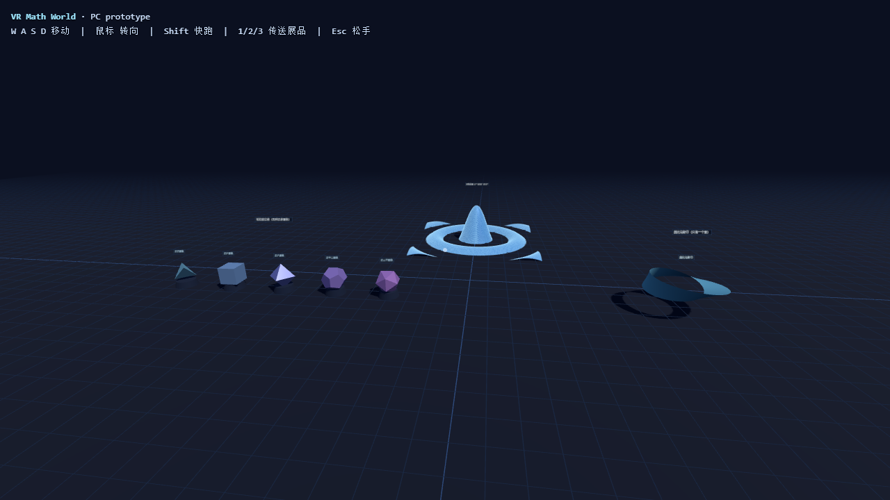

# prototype/ — PC 原型



*（上图是 `?view=1` 的自动截图；`docs/` 下还有立体与莫比乌斯带的近景。）*

第一版目标（对应 VR Math World 路线图的 Phase 2 起步）：**跑通「场景 + 移动 + 数学可视化」这条最小链**。

## 跑起来

```bat
:: 方式一：双击 serve.bat（需要系统里有 python）
:: 方式二：任意静态服务器
python -m http.server 8000
```

然后浏览器打开 <http://127.0.0.1:8000> —— **点击画面**进入，鼠标环视，`W A S D` 走动。
（three.js 已 vendor 到 `vendor/`，**离线可跑**。）

## 操作

| 键 | 作用 |
| --- | --- |
| 点击画面 | 进入第一人称（锁定鼠标） |
| W A S D | 移动（带惯性） |
| Shift | 快跑 |
| 1 / 2 / 3 | 传送到三件展品 |
| Esc | 松开鼠标 |

## 三件展品

1. **函数曲面** `z = sin(r)/r`（160×160 网格，实体 + 线框叠加）
2. **五种柏拉图立体**（正四/六/八/十二/二十面体，带底座与标签）
3. **莫比乌斯带**（参数曲面手工建网格，可看出只有一个面）

## 自动化验证

带 `?view=1..4` 打开会固定在预设机位并跳过交互，方便无头截图对比：

```bat
msedge --headless=new --disable-gpu --window-size=1280,720 --screenshot=shot1.png "http://127.0.0.1:8000/?view=1"
```

## 下一步（按优先级）

- [ ] 展品交互：靠近后按键展开公式/参数滑块（"数学可视化沙盒"）
- [ ] 阅读空间：一块可以"读"的公式/定理牌面（文字排版 + 分页）
- [ ] AI 智能体同伴：先做一个能跟随并搭话的 NPC（接本机的语音服务）
- [ ] WebXR：`renderer.xr.enabled = true` + VR 按钮（等设备到位再接，代码结构已留位）
- [ ] 动作捕捉管线：见仓库根目录「我们怎么分工」一节

## 自检面板

带 `?diag=1` 打开，右上角会显示 WebGL 版本、绘制调用数、三角面数、相机位置与帧率，
页面里的 JS 报错也会直接打在屏幕上 —— 方便在**没有开发者工具**的环境（无头截图、VR 头显）里定位问题。

## 已知限制

- 还没有碰撞检测：可以走到展品里面去（下一步加包围盒）
- 标签是 canvas 贴图精灵，远距离会变小；以后改成随距离自适应
- 只有单机场景，多人/持久化世界还没接
